# LANchat — Complete Project Explanation

> A WhatsApp‑style desktop chat application written from scratch in **Java 8 + Swing**, talking to its own **socket server** over a LAN, storing users in **MySQL**, and protecting every message with a **hand‑built RSA + DES hybrid crypto stack** — no security libraries, no JSON library, no XML library. All of it was implemented by hand.

This document is written so that **someone who has never seen this codebase (or even this kind of app) can understand it end‑to‑end**: what every file is for, how the pieces talk to each other, and *why* each major decision was made. It leans on analogies and worked examples wherever the "why" is subtle.

---

## Table of contents

1. [The 30‑second summary](#1-the-30-second-summary)
2. [How to run it](#2-how-to-run-it)
3. [The big picture (architecture map)](#3-the-big-picture-architecture-map)
4. [Package-by-package tour](#4-package-by-package-tour)
5. [The wire protocol: how the client and server talk](#5-the-wire-protocol-how-the-client-and-server-talk)
6. [Networking & concurrency (sockets + threads + thread pool)](#6-networking--concurrency-sockets--threads--thread-pool)
7. [The hand-written parsers (JSON & XML)](#7-the-hand-written-parsers-json--xml)
8. [The cryptography (the crown jewel)](#8-the-cryptography-the-crown-jewel)
9. [Persistence: database + local files](#9-persistence-database--local-files)
10. [Every end-to-end flow, diagrammed](#10-every-end-to-end-flow-diagrammed)
11. [The UI layer (Swing)](#11-the-ui-layer-swing)
12. [Design decisions & the "why" behind them](#12-design-decisions--the-why-behind-them)
13. [Honest security limitations](#13-honest-security-limitations)
14. [Glossary](#14-glossary)
15. [Timeline diagrams (auth + message lifecycle)](#15-timeline-diagrams-auth--message-lifecycle)

---

## 1. The 30‑second summary

**What it does:** Users register (with an optional profile photo), log in, see a contact list with live online/offline status, and exchange text messages in real time. Messages are **end‑to‑end encrypted** — the server that relays them can never read them. Messages sent to an offline user are queued and delivered when they come back online. Chat history is kept **locally** on each device.

**What makes it interesting (and unusual):** almost every "infrastructure" piece that a normal app would `import` from a library is instead **written by hand in this repo**:

| Normally you'd use… | Here it's hand-built in package… |
|---|---|
| `java.security` RSA | `rsa/` |
| `javax.crypto` DES | `des/` |
| Jackson / Gson (JSON) | `json/` |
| JAXP / DOM (XML) | `xml/` |
| A hashing helper | `security/SHA.java` |

The only real third‑party dependencies are the **MySQL JDBC driver** (to talk to the database), **Thumbnailator** (to shrink profile photos), and NetBeans' **AbsoluteLayout** (a UI layout helper).

**Tech stack at a glance:**
- **Language / platform:** Java 8 (`javac.source=1.8`), NetBeans/Ant project.
- **UI:** Swing, fully custom‑painted, "Tokyo Night" dark theme.
- **Transport:** raw TCP sockets, one line of JSON text per message.
- **Server concurrency:** a fixed thread pool + one thread per connected client.
- **Database:** MySQL (`LANChatApplication` schema).
- **Crypto:** custom RSA (1024‑bit modulus) + custom DES‑style Feistel cipher, combined into a hybrid scheme.

---

## 2. How to run it

**Prerequisites**
- JDK 8+ and the MySQL server running locally.
- The three jars on the classpath (paths are recorded in `nbproject/project.properties`):
  - `mysql-connector-j-8.4.0.jar`
  - `thumbnailator-0.4.20.jar`
  - NetBeans `AbsoluteLayout` library.

**Database setup**
- Run `src/db/chatapplication.sql` once. It creates the `LANChatApplication` database and three tables (`users`, `undeliveredMessages`, `RSAPublicKey`).
- The server connects with the settings hardcoded in `server/DatabaseConnection.java`:
  `jdbc:mysql://localhost:4008/LANChatApplication`, user `root`, password `abcd1234`. Adjust these to match your MySQL instance (note the non‑default port `4008`).

**Start order**
1. Run `server.Server` — it opens a `ServerSocket` on port **8761** and waits.
2. Run the app entry point `chatapplication.ChatApplication` (or `login.Login`) — this opens the Login window. Run it a **second time** (another process) to simulate a second user and chat between them.

> Because the client connects to `127.0.0.1:8761` (`client/Client.java`), by default everything runs on one machine. Point that host at a LAN IP to chat across machines on the same network — hence "LANchat".

---

## 3. The big picture (architecture map)

Think of the system as **three programs** and **two stores**:

- The **Server** process (one, shared).
- Two or more **Client** processes (one Swing app per user).
- A **MySQL database** (server‑side truth: accounts, public keys, offline mailbox).
- Per‑user **local files** on each client (their RSA keypair + their chat history).

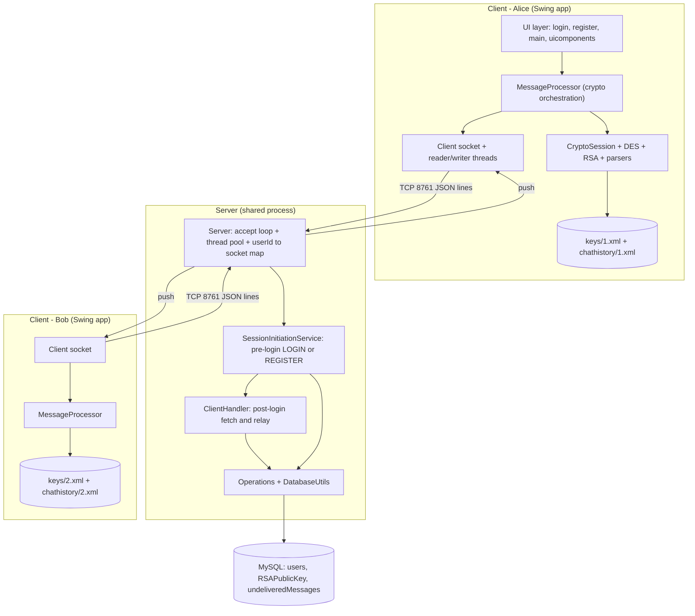

**The single most important idea in the whole project:** the server is a **blind relay**. When Alice messages Bob, the server sees only ciphertext and a "deliver this to user #2" routing hint. It cannot read the message, and it never stores the plaintext. That is why chat history lives on the *clients*, not the server.

---

## 4. Package‑by‑package tour

Every source file and why it exists.

### `chatapplication/` — entry point
| File | Purpose |
|---|---|
| `ChatApplication.java` | `main()`. Just opens the `Login` window on the Swing event thread. This is the project's configured "Main Class". |

### `constants/` — the shared vocabulary between client and server
| File | Purpose |
|---|---|
| `ActionConstants.java` | An `enum` of every message *type* the protocol supports (`LOGIN`, `REGISTER`, `FETCH_ALL_USERS`, `CHAT_MESSAGE`, `GET_PUBLIC_KEY`, …). This is the protocol's verb list. |
| `KeyConstants.java` | An `enum` of every *field name* used inside messages (`ACTION`, `USER_ID`, `MESSAGE`, `METADATA`, `KEY`, `PUBLIC_KEY`, …). These become the JSON keys on the wire. |
| `Status.java` | `SUCCESS` / `FAILURE`, used in login/register replies. |

Why enums? Because both the client and the server compile against the *same* `constants` package, a typo like `"messsage"` becomes impossible — the compiler enforces that both ends agree on the vocabulary.

### `server/` — the shared backend
| File | Purpose |
|---|---|
| `Server.java` | Owns the `ServerSocket`, the accept loop, the thread pool, and the **`userId → Socket` map** (the routing table). Also broadcasts presence changes. |
| `SessionInitiationService.java` | Handles a socket **before** the user is authenticated: only `LOGIN` and `REGISTER`. On success it hands the socket off to a `ClientHandler` and stops. |
| `ClientHandler.java` | Handles a socket **after** login: contact list, online users, profile pictures, public‑key get/set, and **relaying chat messages** (the blind relay). |
| `Operations.java` | Every database operation, each `synchronized`, plus `broadcast()`. The only class that knows SQL. |
| `DatabaseConnection.java` | Lazily opens and caches one JDBC `Connection`. |
| `DatabaseUtils.java` | Thin `executeQuery` / `executeUpdate` helpers using `PreparedStatement`. |

### `client/` — the per‑user front‑half of the network + crypto orchestration
| File | Purpose |
|---|---|
| `Client.java` | Singleton wrapping the TCP `Socket` to the server, plus its reader and writer streams. Handles connect / disconnect / reset (for logout). |
| `ClientInputStream.java` | A background **thread** that blocks reading server lines and dispatches each to `MessageProcessor`. |
| `ClientOutputStream.java` | Thin wrapper that writes a line to the socket. |
| `MessageProcessor.java` | The **brain of the client**: routes every inbound message to a handler, and builds every outbound message — including the entire encrypt‑on‑send / decrypt‑on‑receive crypto pipeline. |
| `CryptoSession.java` | Per‑process crypto state: this user's RSA identity, a cache of contacts' public keys, and a queue of messages waiting for a key. |
| `KeyStorage.java` | Persists this user's RSA keypair to `keys/<userId>.xml` so their identity survives logout/login. |
| `LocalStorage.java` | Persists chat history to `chathistory/<userId>.xml`, one `<contact>` node per conversation. |

### `security/` — crypto interfaces (the contracts)
| File | Purpose |
|---|---|
| `AsymmetricCipher.java` | Interface: `encrypt/decrypt` + `getPublicKey/getPrivateKey`. Implemented by `rsa.RSA`. |
| `SymmetricCipher.java` | Interface: `encrypt/decrypt/generateMetadata/generateAndSetNewKey/setKey`. Implemented by `des.Cipher`. |
| `Hashing.java` | Interface: `getHash`. |
| `SHA.java` | `Hashing` via Java's built‑in SHA‑256, hex‑encoded. Used to hash passwords server‑side. |

### `rsa/` — asymmetric cipher, from scratch
| File | Purpose |
|---|---|
| `RSA.java` | Generates a keypair (two 512‑bit primes → 1024‑bit modulus) and does `modPow`‑based encrypt/decrypt on `BigInteger`s. |
| `RSAPublicKey.java` / `RSAPrivateKey.java` | Hold `(n, e)` and `(n, d)`. |
| `RSAKeyPair.java` | Bundles a public + private key. |

### `des/` — symmetric cipher, from scratch
| File | Purpose |
|---|---|
| `Cipher.java` | The `SymmetricCipher` facade tying encryption/decryption/metadata together. |
| `Encryption.java` / `Decryption.java` | The 16‑round Feistel network (subkey schedule, S‑boxes, permutations). |
| `Metadata.java` | The **cipher configuration**: the key + all permutation tables + S‑boxes, with JSON (de)serialization. A fresh random one is generated **per message**. |
| `SystemMetadata.java` | A single **fixed, hardcoded** metadata blob shared by all clients — used only to bootstrap encryption of the per‑message metadata. |
| `BaseConverter.java` | text↔binary, hex↔binary conversions. |
| `BitManipulations.java` | `cyclicLeftShift`, `XOR` on bit‑strings. |
| `MiscellaneousUtils.java` | Bit padding + random matrix/table generation. |

### `json/` — a hand‑rolled JSON parser
| File | Purpose |
|---|---|
| `JSONHandler.java` | A recursive‑descent parser (`parse`) and serializer (`stringify`) for `Map<String,Object>`. |
| `elements/JSONElement.java` + `JSONObject/JSONArray/JSONString/JSONNumber/JSONBoolean.java` | The typed node classes the parser builds while reading. |

### `xml/` — a hand‑rolled XML parser
| File | Purpose |
|---|---|
| `XMLParser.java` | Turns an XML string into a tree of `XMLNode`s using regex + a stack. |
| `XMLNode.java` | A tag: name, attributes, children, text. |
| `XMLHandler.java` | Wraps parse + adds `stringify`, plus dedicated (de)serializers for RSA public keys and keypairs. |
| `RegexLibrary.java` | The regexes used to find tags and attributes. |

### `parser/` — parser abstractions & small converters
| File | Purpose |
|---|---|
| `Parser.java` | Generic `parse`/`stringify` interface. Both `JSONHandler` and `XMLHandler` implement it. |
| `ByteArrayParser.java` | Serializes a `byte[]` as `"[1, 2, 3]"` text and back — used to send profile‑picture bytes through the text‑only JSON channel. |
| `MiscellaneousParser.java` | `int[][] ↔ List<List<Integer>>` helpers, used by DES metadata (de)serialization. |

### `login/`, `register/`, `main/` — the three screens
| File | Purpose |
|---|---|
| `login/Login.java` (+ `.form`) | Login screen; sends the `LOGIN` message. |
| `register/Register.java` (+ `.form`) | Registration screen; picks/shrinks a photo, validates fields, sends `REGISTER`. |
| `main/Main.java` (+ `.form`) | The chat shell after login: contact list, presence, profile, send/receive wiring, logout. |

### `uicomponents/` — reusable custom Swing widgets
Presentation only. `Theme` (colors/fonts), `TitleBar`, `GradientSidePanel`, `RoundedButton`, `SideRail`, `ChatListUI` + `ChatItem`, `ConversationPanel`, `MessagePanel` + `SentMessagePanel`/`ReceivedMessagePanel`, `InitialMessagePanel`, `ProfilePanel`, `ContentArea`, `AvatarPainter`, `StatusPill`, `BackChevron`. Covered in [section 11](#11-the-ui-layer-swing).

---

## 5. The wire protocol: how the client and server talk

### 5.1 One connection, newline‑delimited JSON

Each client keeps **one long‑lived TCP socket** to the server. Every message is a **single line of JSON text** terminated by a newline. The receiver reads with `BufferedReader.readLine()`, so "one line = one message" is the framing rule.

A message is always a flat JSON object whose keys are `KeyConstants` names and whose `ACTION` value is an `ActionConstants` name. For example, a login request looks like:

```json
{"ACTION": "LOGIN", "USERNAME": "alice", "PASSWORD": "hunter2xy"}
```

Because `ActionConstants` and `KeyConstants` are enums shared by both sides, the string `"LOGIN"` on the wire is just `ActionConstants.LOGIN.toString()`, and it's turned back into the enum with `ActionConstants.valueOf(...)`.

### 5.2 The action catalogue

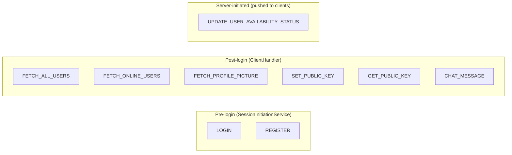

| Action | Direction | Meaning |
|---|---|---|
| `LOGIN` | client → server, then reply | Authenticate. Reply carries `STATUS` + (on success) the user's own id/name/username/email. |
| `REGISTER` | client → server, then reply | Create an account; on success it *also* logs you in (same handoff as LOGIN). |
| `FETCH_ALL_USERS` | request/reply | The full contact list, sent back as **parallel arrays** `USER_IDS` + `USER_NAMES`. |
| `FETCH_ONLINE_USERS` | request/reply | The `ONLINE_USERS` id array. |
| `UPDATE_USER_AVAILABILITY_STATUS` | server → all clients | Broadcast when anyone goes online/offline. |
| `FETCH_PROFILE_PICTURE` | request/reply | `PROFILE_PIC` as a stringified `byte[]`. |
| `SET_PUBLIC_KEY` | client → server | Publish my RSA public key (XML) after login. |
| `GET_PUBLIC_KEY` | request/reply | Fetch a contact's public key so I can encrypt to them. |
| `CHAT_MESSAGE` | client → server → client | The encrypted message envelope, routed by `RECEIVER_ID`. |

### 5.3 Why parallel arrays for the user list?

The hand‑rolled JSON serializer can stringify a flat map and simple arrays, but it has **no clean way to serialize an array of objects** (a `List<{id,name}>`). So instead of `[{id:1,name:"A"},…]`, the server sends two aligned arrays: `USER_IDS=[1,2]` and `USER_NAMES=["A","B"]`, and the client zips them back together. This is called out explicitly in `KeyConstants.java`. It's a pragmatic workaround for a from‑scratch parser.

---

## 6. Networking & concurrency (sockets + threads + thread pool)

This is where "socket programming" and "multithreading / thread pool" live.

### 6.1 Server side: accept loop + thread pool

`Server.main()` does four things:

```java
userIdSocketMap = new HashMap<Integer, Socket>();
ServerSocket server = new ServerSocket(8761);
ExecutorService service = Executors.newFixedThreadPool(Runtime.getRuntime().availableProcessors());
while (true) {
    Socket client = server.accept();               // blocks until someone connects
    service.execute(new SessionInitiationService(client));
}
```

**Analogy:** the `ServerSocket` is the front door with a doorbell. `accept()` is standing at the door waiting for the bell. When a guest arrives, you don't stop everything to entertain them yourself — you hand them to a **host from a fixed pool of hosts** (`newFixedThreadPool`) and immediately go back to the door for the next guest. The pool is sized to the number of CPU cores, so the machine is never asked to juggle more truly‑concurrent workers than it has cores for.

**The two‑phase handler design — why there are two handler classes:**

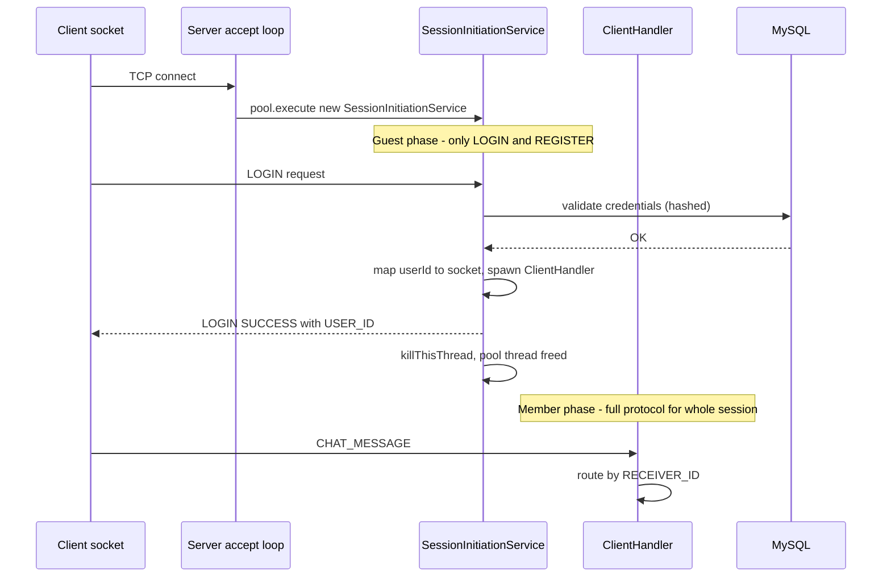

- **`SessionInitiationService`** is the "bouncer at the door." It runs on a **pooled** thread and only understands `LOGIN` / `REGISTER`. The moment authentication succeeds, it (a) records the `userId → socket` mapping, (b) starts a dedicated `ClientHandler` for the rest of the session, (c) sends the success reply, (d) flushes any offline messages, and (e) **kills its own loop** (`isGuestSessionAlive = false`) so the pooled thread is freed back to serve the next new connection.
- **`ClientHandler` extends `Thread`** and is the "member's personal host." It gets its **own** thread (not a pooled one) that lives for the whole logged‑in session, blocking on `readLine()` and handling every post‑login action. When `readLine()` returns `null` (socket closed), its `finally` block runs `processWhenUserGoesOffline(...)` — that's how a disconnect automatically marks the user offline and broadcasts it.

**Why split them?** The pool has a *bounded* number of threads. If a pooled thread stayed occupied for the entire duration a user is logged in (possibly hours), then N cores would cap you at N simultaneous *logged‑in* users. By having the pool only do the short login handshake and then handing long‑lived sessions to dedicated threads, the pool stays free to keep accepting and authenticating new arrivals quickly. (The dedicated‑thread‑per‑session model itself doesn't scale to thousands of users, but for a LAN chat app it's simple and correct.)

### 6.2 The routing table

`Server` keeps `HashMap<Integer, Socket> userIdSocketMap`. This is the **switchboard**: given a `RECEIVER_ID`, look up their live socket and write to it. If they're not in the map, they're offline. Presence is derived from this map plus a `status` column in the DB.

### 6.3 Why every `Operations` method is `synchronized`

`DatabaseConnection` hands out **one shared JDBC `Connection`** for the whole server. But there are many threads (one per client). A JDBC `Connection` — and the `Statement`/`ResultSet` it produces — is **not safe for concurrent use**. If two client threads ran a query at the same time on the same connection, one could clobber the other's result set mid‑read.

Every DB method in `Operations` is `static synchronized`, so they all lock on the same `Operations.class` monitor. That means each query's full "execute → read all rows" lifecycle finishes before any other thread can start its own query. It serializes DB access — slower, but correct. (The file itself documents this reasoning in a long comment.)

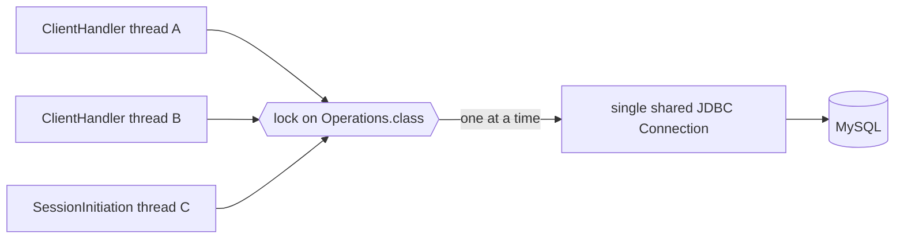

### 6.4 Client side: one socket, one reader thread, and the UI thread

`Client` is a **singleton** holding the socket plus:
- a `ClientInputStream` (**a `Thread`**) that loops on `readLine()` and pushes each inbound line into `MessageProcessor.handleReceivedMessage(...)`;
- a `ClientOutputStream` for writing.

So a client has (at least) **three threads of interest**:
1. The **Swing Event Dispatch Thread (EDT)** — all UI painting and event handling.
2. The **`ClientInputStream` reader thread** — receives server pushes at any time.
3. Whatever thread triggers a **send** (usually the EDT, from a button click).

The reader thread must never touch Swing components directly. That's why `Main`'s public callbacks (`populateContacts`, `updateOnlineUsers`, `receiveMessage`, `updateProfilePicture`, …) all wrap their work in `java.awt.EventQueue.invokeLater(...)` — they **marshal** the update from the network thread onto the EDT. This is the standard Swing threading rule, and the code follows it consistently.

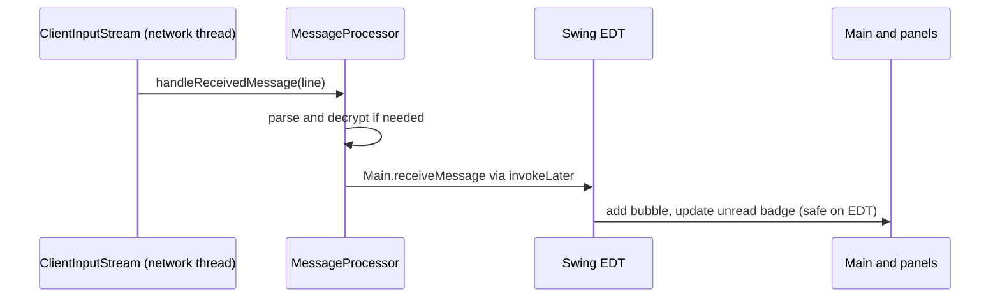

### 6.5 Logout and reconnect

`Client.disconnect()` closes the socket (the server notices and marks the user offline). `Client.reset()` drops the singleton so the next `getClient()` opens a **fresh** connection. `CryptoSession.reset()` clears in‑memory crypto state (but **not** the on‑disk keypair). Together these let a user log out and a different user log in cleanly in the same process.

---

## 7. The hand‑written parsers (JSON & XML)

Both parsers implement the same tiny `Parser<T>` interface (`parse` + `stringify`), so callers don't care which format is underneath.

### 7.1 JSON (`json/JSONHandler.java`) — recursive descent

`JSONHandler` is a **singleton recursive‑descent parser**. It walks the string character by character with a shared `index`, and each grammar rule is a method:

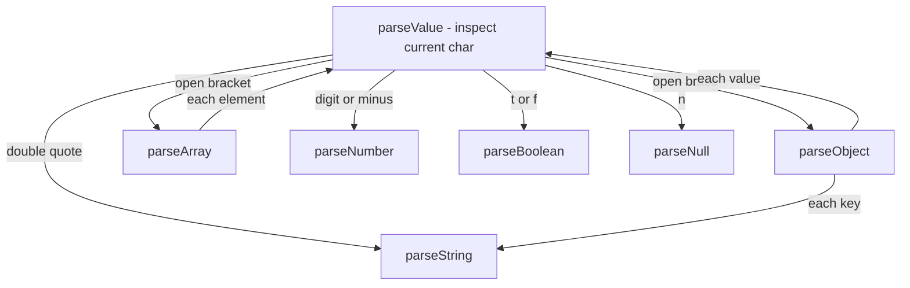

- `parseObject` consumes `{`, then repeatedly reads a `"key"`, a `:`, a value (recursing into `parseValue`), and an optional `,`, until `}`.
- `parseArray` is the same shape for `[ … ]`.
- The build produces typed `JSONElement` nodes (`JSONObject`, `JSONArray`, `JSONString`, `JSONNumber`, `JSONBoolean`). Calling `.getValue()` on the root recursively unwraps the whole tree into plain Java `Map`/`List`/`String`/`Number`/`Boolean`. This two‑stage design (typed nodes → plain values) keeps parsing logic separate from the "give me ordinary Java objects" conversion.

**Escaping matters.** `stringify()` escapes `\`, `"`, `\n`, `\t`; `parseString()` **reverses** those escapes. This isn't cosmetic: DES ciphertext and serialized metadata contain quotes and backslashes, and without matched escaping a single embedded `"` would truncate the string and corrupt the whole parse. The code comments call this out at the exact spot.

**The `JSONElement` hierarchy:**

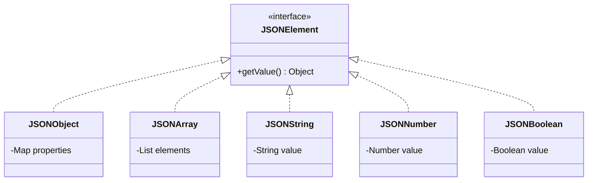

**Number handling:** a token with a `.` becomes a `Double`, otherwise an `Integer`. That's why the client casts fetched ids to `Integer`.

### 7.2 XML (`xml/XMLParser.java`) — regex + stack

XML is used for things that are naturally **tree‑shaped and stored to disk**: RSA keys and chat history. `XMLParser` uses a regex (`FETCH_TAGS`) to walk tag‑by‑tag and a **stack** to track nesting:

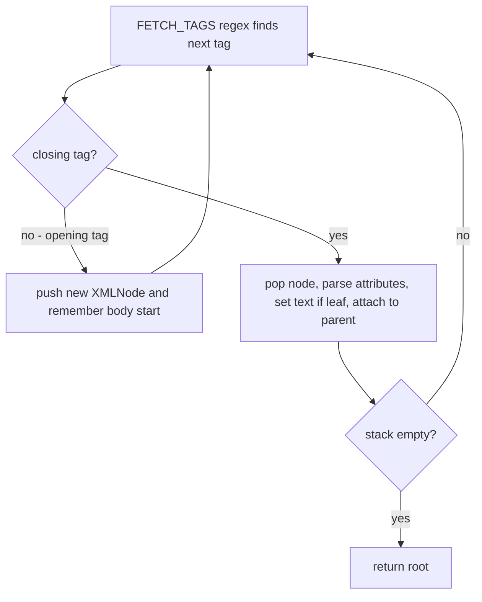

- Opening tag → push a new `XMLNode`.
- Closing tag → pop, run `parseAttributes` (a second regex, `FETCH_ATTRIBUTES`, matching `name="value"` pairs), set its text if it's a leaf, and attach it to whatever is now on top of the stack (its parent).
- When the stack empties, the tree is complete.

`XMLNode` is a plain tree node (`tagName`, `attributes`, `children`, `text`). `XMLHandler` adds a `stringify()` that walks the tree back into a string, plus four **domain‑specific helpers** that are the real reason XML exists here:

- `stringifyRSAPublicKey` / `parseRSAPublicKey` — put an `(n, e)` pair on the wire for `SET/GET_PUBLIC_KEY`.
- `stringifyRSAKeyPair` / `parseRSAKeyPair` — persist a full `(n, e, d)` keypair to disk.

> **Gotcha the code handles:** `XMLHandler.stringify` / `XMLParser` do **not** escape text content. So `LocalStorage` escapes `< > &` itself before storing a chat message, and unescapes on load. Otherwise a message containing `<` would break the tree. (RSA keys and DES metadata are pure digits, so they're safe without escaping.)

### 7.3 `parser/` helpers

- `ByteArrayParser` (singleton) turns a `byte[]` into `"[12, -7, 40]"` and back. This is how **binary profile‑picture data survives a text‑only JSON channel**: convert to a bracketed list of decimal bytes, ship as a string, parse back to bytes.
- `MiscellaneousParser` converts between primitive `int[][]` and `List<List<Integer>>` (and boxes `int[]`→`Integer[]`). DES metadata serialization needs this because the JSON layer speaks in `List`/`Integer`, but the cipher speaks in `int[][]`.

---

## 8. The cryptography (the crown jewel)

This section explains, precisely and with examples: how RSA keys are generated, how a message is encrypted, and — the subtle part — **how the DES "metadata" is itself securely encrypted**.

### 8.1 Why hybrid encryption at all (the analogy)

RSA is like a **mailbox with a public slot**: anyone can drop something in using your public key, but only your private key opens it. The catch: RSA can only encrypt numbers smaller than its modulus `n`, so it's only practical for **small** payloads. Encrypting a whole conversation with RSA directly would be slow and size‑limited.

DES is like a **fast lockbox with a single shared key**: great for bulk data, but both parties must somehow agree on the key first — and you can't just send the key in the clear.

**Hybrid encryption combines them:** encrypt the *message* with fast symmetric DES, then encrypt just the *small DES key* with RSA. You get RSA's "no shared secret needed" **and** DES's speed. That's exactly the shape here — with an extra twist unique to this project.

### 8.2 RSA from scratch (`rsa/RSA.java`)

**Key generation** (in the constructor):

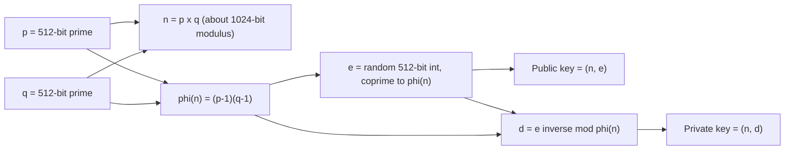

- `p`, `q` come from `BigInteger.probablePrime(512, SecureRandom)`.
- `n = p·q` is ~1024 bits. `φ(n) = (p−1)(q−1)`.
- `e` is found by `getRelativelyPrimeBigInteger`: pick random 512‑bit integers until one is coprime to `φ(n)` (`gcd == 1`).
- `d = e.modInverse(φ(n))`.

**Operations** (textbook RSA on `BigInteger`s):
- `encrypt(m, pub) = m^e mod n` — but only if `m < n` (it returns `null` otherwise, guarding the size limit).
- `decrypt(c, priv) = c^d mod n`.

`RSA` implements `AsymmetricCipher`, and crucially its `encrypt`/`decrypt` operate **purely on the keys passed in** — they never secretly use the instance's own keypair. That's why `CryptoSession` can keep one reusable `RSA operator` just to call the math, while the actual identity keys live separately.

### 8.3 DES from scratch (`des/`)

This is a **DES‑style 16‑round Feistel cipher**, but with a twist: instead of DES's famous fixed tables, **every table is randomly generated per message** and travels (encrypted) alongside the ciphertext. `Metadata` holds that configuration:

| Field | What it is |
|---|---|
| `key` | 64 characters of `'0'`/`'1'` (the DES key material). |
| `IP` / `IPInverse` | 8×8 initial permutation and its inverse. |
| `PC1` / `PC2` | Key‑schedule permutations (64→56, 56→48). |
| `eBitSelectionTable` | The 32→48 expansion. |
| `P` | The 32‑bit round permutation. |
| `S1…S8` | Eight 4×16 S‑boxes. |
| `numberOfLeftShifts` | The per‑round key rotation amounts. |

`MiscellaneousUtils.generateMatrix(...)` builds these — either a shuffled permutation of a range (for permutation tables) or random values (for S‑boxes / key bits). `Metadata`'s no‑arg constructor generates a completely fresh random cipher configuration.

**The encryption round structure** (`Encryption.java`), for one 64‑bit block:

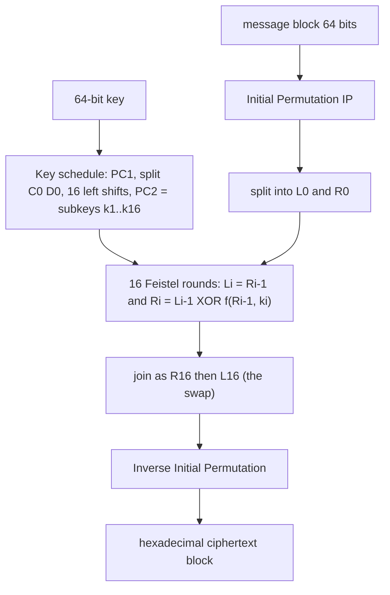

The round function `f` (the "mangler"): expand `R` with `eBitSelectionTable` (32→48), XOR with the round subkey, run it through the 8 S‑boxes (48→32), then permute with `P`. Text is first converted to bits at **7 bits per character** (`BaseConverter.textToBinary`) and processed in 56‑bit chunks padded to 64. `Decryption.java` is identical but applies the subkeys in reverse order (`k16…k1`).

You don't need to trace every bit to understand the system — the key takeaway is: **DES here = (a per‑message key) + (a per‑message set of random tables), both bundled in a `Metadata` object.**

### 8.4 `SystemMetadata` — the one fixed cipher config

`SystemMetadata.JSON` is a **hardcoded, non‑secret** `Metadata` blob (fixed tables + a placeholder key) that **every client compiles in**. It is *not* used to encrypt messages. Its only job: give both sides a **known, shared cipher configuration** to encrypt/decrypt the *per‑message metadata* — before any per‑message key has been exchanged. Think of it as a **standard envelope format** everyone already owns, used only to seal the real (randomized) instructions inside.

### 8.5 The full send pipeline — two keys, nested

This is the part worth reading slowly. When Alice sends "hi" to Bob (`MessageProcessor.dispatchEncryptedChatMessage`), **two different DES keys** and **two different table‑sets** come into play.

Let's name them:
- **K1** + **random tables T** — encrypt the actual message. Both live inside the freshly generated `messageMetadata`.
- **K2** — a second fresh key. It encrypts `messageMetadata` (using the fixed `SystemMetadata` tables), and **K2 is the only thing RSA protects**.

Step by step:

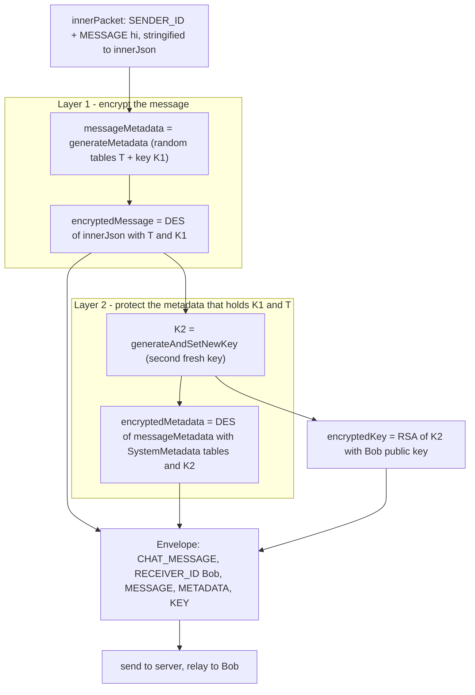

Why this nesting instead of "just RSA‑wrap the DES key"? Because the DES key here is **not** the whole secret — the **random tables are too**. The full `messageMetadata` (tables + K1) is far too large to fit through RSA (it must be `< n`). So the design:
1. Encrypts the bulky `messageMetadata` **symmetrically** with a bootstrap key **K2** and the public `SystemMetadata` tables (fast, no size limit), and
2. RSA‑wraps only the **tiny K2**.

So the only asymmetric operation is on one small 64‑bit key, and *everything* that reveals how the message was encrypted (the tables + K1) is itself encrypted. The server sees three opaque blobs.

**A subtlety the code fixes — leading zeros (`padKey`).** K2 is a 64‑character `'0'/'1'` string. To RSA it, it's turned into a `BigInteger` and back. A `BigInteger` has no concept of "leading zeros," so a key like `0011…` would come out of RSA as `11…` — shorter, and DES would then derive the wrong subkeys. `MessageProcessor.padKey` re‑left‑pads the decrypted key back to exactly 64 characters. Small detail, total‑failure bug if missed.

### 8.6 The receive pipeline (mirror image)

`MessageProcessor.handleChatMessage` reverses everything, using Bob's **private** key:

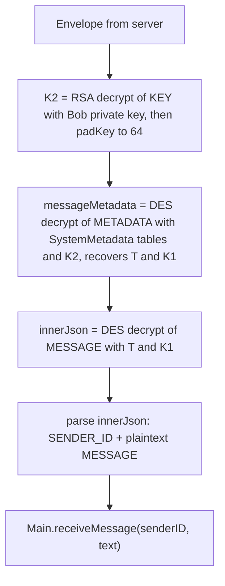

1. RSA‑decrypt `KEY` with the private key → **K2** (re‑padded).
2. DES‑decrypt `METADATA` using the shared `SystemMetadata` tables + K2 → recover the per‑message `messageMetadata` (which contains **T + K1**).
3. DES‑decrypt `MESSAGE` using that recovered metadata → the inner JSON.
4. Parse out `SENDER_ID` and the plaintext, hand to the UI.

At no point did the server have K2, K1, the tables, or the plaintext.

### 8.7 Key distribution & the pending‑message queue

To encrypt to Bob, Alice needs Bob's **public key**. The flow:

- After login, each client publishes its own public key with `SET_PUBLIC_KEY` (`Main.sendOwnPublicKey`), stored in the `RSAPublicKey` table.
- When Alice sends to Bob for the first time, `sendChatMessage` checks `CryptoSession`'s cache. On a miss it **queues the plaintext** and fires `GET_PUBLIC_KEY`. When the reply arrives (`handleGetPublicKey`), it caches Bob's key and **drains the queue**, encrypting and dispatching each held message.
- If the reply's key is `null` (Bob has *never* logged in, so no key exists), the queued messages are dropped and the UI shows a "hasn't finished setting up their account" warning (`Main.messageDeliveryFailed`) — rather than failing silently.

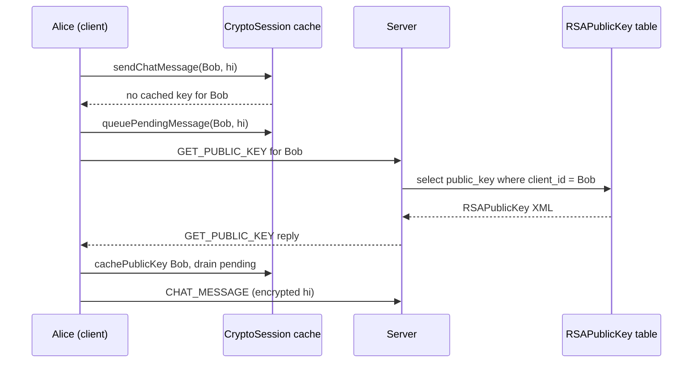

### 8.8 Passwords: SHA‑256, server‑side only

Passwords are sent from the client as **plaintext over the socket** (there's no TLS here), and hashed **on the server** with `SHA` (SHA‑256, hex) in both `createAccount` (store the hash) and `validateUserCredentials` (compare the hash). So the database never holds a plaintext password. See [limitations](#13-honest-security-limitations) for the honest caveat about the plaintext‑on‑the‑wire part.

---

## 9. Persistence: database + local files

### 9.1 MySQL schema (`src/db/chatapplication.sql`)

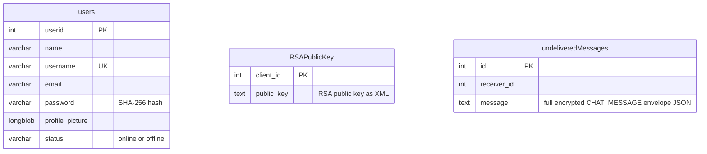

- **`users`** — accounts. `password` is a SHA‑256 hash, `profile_picture` is a `LONGBLOB`, `status` tracks presence.
- **`RSAPublicKey`** — one public key per user, stored as XML text; upserted on `SET_PUBLIC_KEY`.
- **`undeliveredMessages`** — the **offline mailbox**. When a `CHAT_MESSAGE`'s receiver isn't connected, the server stores the *entire encrypted envelope* here (still ciphertext — the server can't read it). On the receiver's next login, `flushUndeliveredMessages` sends every queued row back and deletes them.

### 9.2 Local file: the RSA keypair (`keys/<userId>.xml`)

Written by `KeyStorage`, one file per user. This is the user's **cryptographic identity**, kept locally so it's stable across logins. Real sample from `keys/1.xml`:

```xml
<RSAKeyPair>
  <n>90207137256502830034488817073051790487098301396094255305480590803755470080258614070303292531018847082842358915738448267116811724461770061073167208859421977046852941630437778128036301355300804593341357422876614240189408067294897561558838946132622563161188669366662794814431514729414159495530594587240053309797</n>
  <e>6050375185422877459697798159332620417336650287437831779334135385337527512078170187653946817330647233515156841124965615628697591370743214488035599445527047</e>
  <d>86442485722709296739873341350746937996841915434805774973451223068419673461153527009644555889776725952523389182551646346502705836066260249789543394506877728469109160350460494740053288975070874832043421087655040644983138612866735391714445764767122222467356508496155795378082171450371283676361975725025427674483</d>
</RSAKeyPair>
```
*(shown pretty‑printed; on disk it's a single line)*

**Why persist it?** `CryptoSession` explains the hazard: if a fresh keypair were generated every login, then any message the server queued for you (encrypted against your *old* public key) would become **permanently undecryptable** the moment you log back in with a new identity. Persisting the keypair keeps your public key on the server valid.

### 9.3 Local file: chat history (`chathistory/<userId>.xml`)

Written by `LocalStorage`, one file per user, one `<contact>` node per conversation. Real sample from `chathistory/1.xml`:

```xml
<history>
  <contact id="2">
    <message time="9:58 PM" sent="true">sending a message</message>
    <message time="9:58 PM" sent="false">hello</message>
    <message time="10:11 PM" sent="false">This should show up as undelivered</message>
  </contact>
</history>
```

`sent="true"` means "I sent it"; `false` means "I received it." Because the **server never sees plaintext**, history has to live where the plaintext exists — on the device that decrypted it. On send and on receive, `Main` calls `LocalStorage.append(...)`; when you open a chat, `Main.selectChat` replays the stored bubbles.

> Both `keys/` and `chathistory/` are in `.gitignore` — they're per‑user runtime data, not source.

---

## 10. Every end‑to‑end flow, diagrammed

### 10.1 Application startup & window navigation

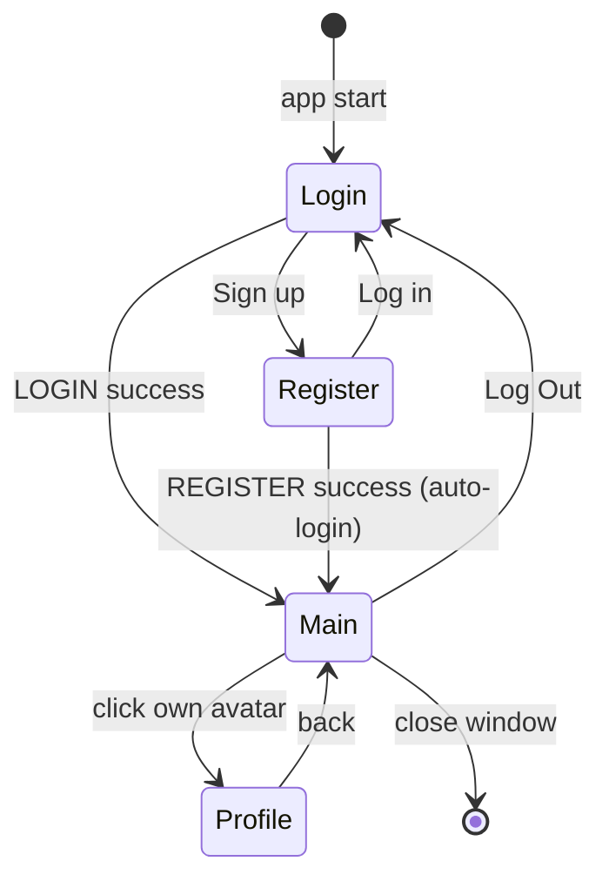

### 10.2 Registration

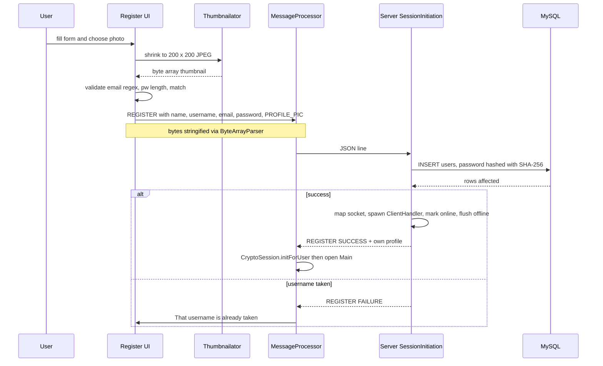

Note the profile photo path: `Register` uses **Thumbnailator** to shrink the chosen image to 200×200, encodes it to JPEG bytes, then **`ByteArrayParser`** stringifies those bytes so they can ride inside JSON.

### 10.3 Login

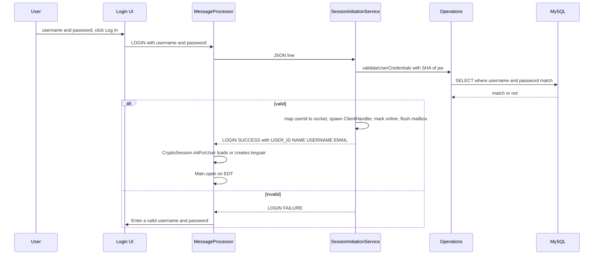

### 10.4 What `Main` does the moment it opens

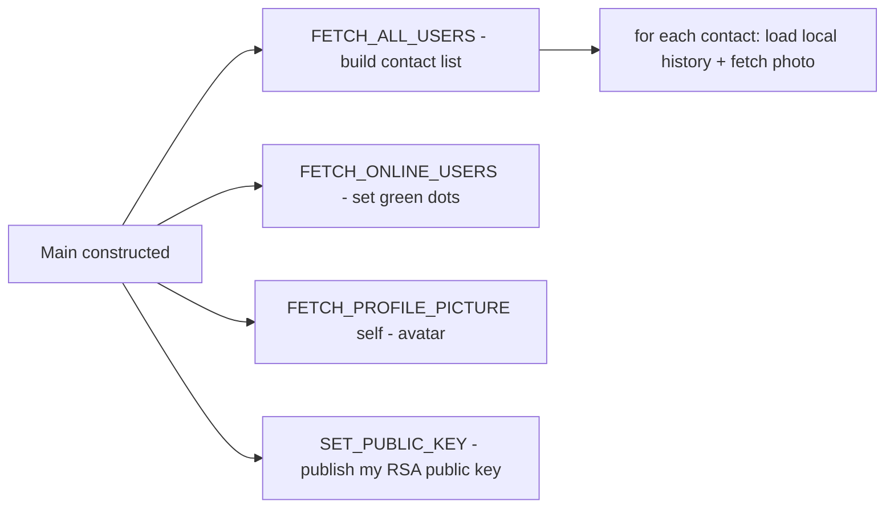

### 10.5 Presence broadcast (online/offline)

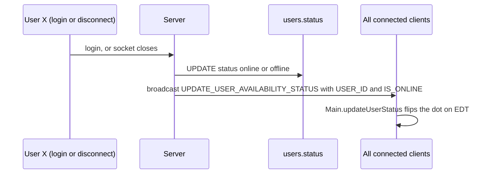

### 10.6 Sending to an **online** receiver (the happy path)

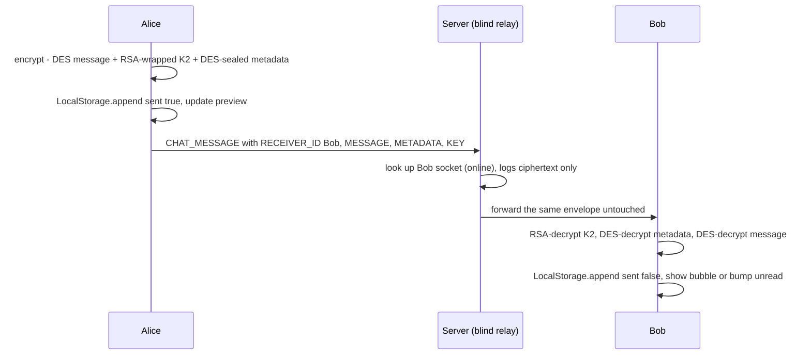

### 10.7 Sending to an **offline** receiver (store‑and‑forward)

```mermaid
sequenceDiagram
    participant A as Alice
    participant SV as Server
    participant DB as undeliveredMessages
    participant B as Bob (offline then online)

    A->>SV: CHAT_MESSAGE with RECEIVER_ID Bob
    SV->>SV: Bob not in userId to socket map
    SV->>DB: INSERT receiver_id Bob and full encrypted envelope JSON
    Note over B: time passes
    B->>SV: LOGIN success
    SV->>DB: SELECT and DELETE undelivered for Bob
    SV-->>B: replay each stored envelope
    B->>B: decrypt with own private key, render
```

The envelope stored is **self‑contained** — it already carries the RSA‑wrapped K2 for Bob — so it decrypts correctly whenever he returns.

### 10.8 Sending to someone who has **never logged in** (no key exists)

```mermaid
sequenceDiagram
    participant A as Alice
    participant SV as Server

    A->>A: no cached key, queue message, send GET_PUBLIC_KEY
    A->>SV: GET_PUBLIC_KEY for target
    SV-->>A: PUBLIC_KEY is null (never published one)
    A->>A: drop queued messages, warn user via dialog
```

### 10.9 Logout

```mermaid
flowchart LR
    LO["Log Out clicked"] --> D["Client.disconnect - close socket"]
    D --> R["Client.reset - drop singleton"]
    R --> C["CryptoSession.reset - clear in-memory keys and cache, keeps keypair file"]
    C --> W["dispose Main, show Login"]
    D -.-> SV["server sees disconnect, marks offline, broadcasts"]
```

---

## 11. The UI layer (Swing)

The UI is **fully custom‑painted Swing** with a consistent dark "Tokyo Night" palette. No UI images are shipped — everything (gradients, bubbles, avatars, icons) is drawn with Java2D. There's a deliberate reason: a previous version of this project broke on other machines because of hardcoded absolute image paths, so the illustration/side panels are drawn in code and simply cannot have that failure mode (documented in `GradientSidePanel`).

### 11.1 Screen composition

```mermaid
flowchart TD
    Main["Main (JFrame)"] --> TitleBar["TitleBar"]
    Main --> SideRail["SideRail - icon rail + own avatar"]
    Main --> ContentArea["ContentArea"]
    ContentArea -->|"card chat"| ChatListUI["ChatListUI left - search + ChatItem rows"]
    ContentArea -->|"card chat"| ConversationPanel["ConversationPanel right"]
    ContentArea -->|"card profile"| ProfilePanel["ProfilePanel"]
    ConversationPanel -->|"empty"| InitialMessagePanel["InitialMessagePanel"]
    ConversationPanel -->|"active"| Bubbles["header + message bubbles + input bar"]
    ChatListUI --> ChatItem["ChatItem"]
    ChatItem --> AvatarPainter["AvatarPainter"]
    ProfilePanel --> AvatarPainter
    SideRail --> AvatarPainter
```

- **`Theme`** centralizes every color and font; `avatarColorFor(name)` deterministically maps a name to a stable avatar color (so a contact keeps the same color), deliberately excluding green/orange/red because those carry *meaning* elsewhere (online status, unread badge, danger).
- **`ContentArea`** uses a `CardLayout` to swap between the chat view (contact list + conversation side by side) and the full‑area profile view.
- **`ConversationPanel`** swaps between an empty placeholder and an active conversation, appends message bubbles, and auto‑scrolls to the newest. It exposes a `MessageSendListener` that `Main` wires to the encryption/send + local‑store path.
- **`AvatarPainter`** is shared avatar rendering: a real photo clipped to a circle if present, otherwise a colored initial. It also decodes raw image bytes from `FETCH_PROFILE_PICTURE`.
- **`TitleBar`** gives the undecorated window back its drag‑to‑move and close behavior.
- Custom‑drawn glyphs (`SendButton` triangle, `BackChevron`) are hand‑painted specifically because Unicode arrow characters aren't guaranteed to exist in every installed font and can render as blank "tofu" boxes.

### 11.2 The `.form` files

`Login.form`, `Register.form`, and `Main.form` are **NetBeans GUI‑builder descriptors**. NetBeans reads them to regenerate the `initComponents()` method (the block between the `//GEN-BEGIN` / `//GEN-END` markers). You edit layout visually in NetBeans; you don't hand‑edit the generated block. The non‑generated methods (event handlers, network calls) are ordinary code.

### 11.3 A UI threading detail worth knowing

`Main.preventSearchFieldFromStealingInitialFocus()` fixes a real Swing quirk: on window open, focus went to the search field, which immediately fired its focus listener and wiped its own placeholder before anyone could read it. The fix steals focus back to a neutral component once the window is showing. It's a small illustration of the care taken around Swing's event model.

---

## 12. Design decisions & the "why" behind them

| Decision | Why |
|---|---|
| **Blind‑relay server** (never decrypts) | True end‑to‑end privacy: a compromised or curious server still can't read messages. Forces history to live client‑side. |
| **Hybrid RSA + DES** | RSA alone can't encrypt bulk data (size limit, slow); DES alone needs a pre‑shared key. Combine: DES for the message, RSA for the small key. |
| **Per‑message random DES tables (metadata)** | Every message uses a freshly randomized cipher configuration, not just a fresh key — nothing about one message's cipher setup carries to the next. |
| **`SystemMetadata` fixed tables** | A shared, known cipher config both sides own up‑front, used *only* to encrypt the per‑message metadata before any key exchange — bootstrapping. |
| **RSA‑wrap only K2, DES‑seal the metadata** | The full metadata (tables + K1) is too big for RSA (`m < n`). Seal it symmetrically with K2; RSA only protects the tiny K2. |
| **`padKey` re‑padding** | `BigInteger` drops leading zeros; a `'0'…`‑prefixed 64‑bit key would return short and break subkey derivation. |
| **Persist RSA keypair to disk** | A new identity each login would strand offline messages encrypted against the old public key, permanently. |
| **Two server handler classes** | Keep the bounded thread pool free for fast login handshakes; give long‑lived sessions their own dedicated threads. |
| **`synchronized` DB methods** | One shared JDBC connection across many threads isn't concurrency‑safe; serialize access to avoid scrambled result sets. |
| **Hand‑rolled JSON/XML** | Educational goal — build the infrastructure, not import it. JSON for the wire (flat messages), XML for tree‑shaped, on‑disk data (keys, history). |
| **Parallel arrays for user lists** | The from‑scratch JSON serializer can't cleanly emit an array of objects; two aligned arrays sidestep that. |
| **`ByteArrayParser`** | Ships binary image data through a text‑only JSON channel by encoding bytes as a bracketed decimal list. |
| **Escaping in JSON & `LocalStorage`** | Ciphertext/messages contain `"` `\` `<` `>` `&`; unescaped, these corrupt the parse or the XML tree. |
| **Fully code‑painted UI, no image files** | A prior version broke from hardcoded absolute image paths; drawing in code removes that failure mode entirely. |
| **SHA‑256 passwords, hashed server‑side** | The DB never stores plaintext passwords. |

---

## 13. Honest security limitations

This is a learning project with a genuinely interesting crypto design, but it is **not** production‑grade. Being upfront:

- **The transport is plaintext TCP.** Passwords are sent to the server in the clear (hashed only after arrival). A network eavesdropper on the LAN could read them. Real systems put TLS under everything.
- **The DES/RSA are textbook, unauthenticated implementations.** No message authentication (MAC/AEAD) means ciphertext integrity isn't verified; there's no padding scheme like OAEP on RSA; DES‑class block sizes/keys are small by modern standards. This is fine for demonstrating the *mechanics* of hybrid encryption; it isn't fine for protecting real secrets.
- **No forward secrecy / no key verification.** Public keys are trusted as the server hands them out (no fingerprint check), so a malicious server could substitute keys (a classic man‑in‑the‑middle) even though it can't read messages passively.
- **DB credentials are hardcoded** in `DatabaseConnection` and a `SecureRandom`‑seeded but small‑parameter RSA is used.

None of this diminishes the project's value as a from‑scratch demonstration of sockets, threads, custom parsers, and — especially — a working hybrid cryptosystem. It just shouldn't be mistaken for a hardened messenger.

---

## 14. Glossary

- **EDT (Event Dispatch Thread):** the single Swing thread where all UI code must run. Background threads marshal onto it via `invokeLater`.
- **Feistel network:** the round structure DES uses — split the block in two, repeatedly mix one half into the other with a round key.
- **Hybrid encryption:** encrypt bulk data with a fast symmetric cipher, then encrypt that symmetric key with a slower asymmetric one.
- **Metadata (in this project):** a bundle of a DES key **plus** all the permutation tables and S‑boxes — the full cipher configuration for one message.
- **`SystemMetadata`:** the single fixed, public cipher configuration every client compiles in, used only to bootstrap encryption of per‑message metadata.
- **K1 / K2:** K1 encrypts the message (inside the metadata); K2 encrypts the metadata and is the only thing RSA protects.
- **Blind relay:** a server that forwards messages by routing hint alone, never decrypting them.
- **Recursive‑descent parser:** a parser with one function per grammar rule that calls itself for nested structures — how `JSONHandler` works.
- **Store‑and‑forward:** hold a message for an offline recipient and deliver it when they reconnect (the `undeliveredMessages` mailbox).

---

## 15. Timeline diagrams (auth + message lifecycle)

Two step‑by‑step timelines. For each I give a **`timeline` overview** (the chronological milestones, read top to bottom) followed by a **detailed `sequenceDiagram`** that shows every actor and every step — key generation, encryption, decryption, parsing/stringifying, and the offline (undelivered) side branch.

### 15.1 User authentication, connection & key generation

**When and how the RSA keypair is generated:** it happens on the **reader thread**, the instant the `LOGIN SUCCESS` reply arrives, inside `CryptoSession.initForUser(...)` — *before* any queued offline message is processed. On the very first login the keypair is generated and saved; on every login after that it is loaded from `keys/<userId>.xml`, so the identity is stable.

```mermaid
timeline
    title User Authentication, Connection and RSA Key Generation
    section Launch
        App start : ChatApplication.main runs : Login window shown on the EDT
    section Connect to server
        User clicks Log In : Client.getClient opens TCP socket to port 8761 : ClientInputStream reader thread starts
    section Authenticate
        Server reads LOGIN : SessionInitiationService on a pool thread : Operations validates username and SHA-256 password
        On success : userId mapped to socket : dedicated ClientHandler thread spawned : user marked online and presence broadcast
    section Establish RSA identity
        Reply arrives on reader thread : CryptoSession.initForUser runs
        Load keypair : KeyStorage reads keys id xml if it exists
        First ever login : new RSA keypair generated : saved to keys id xml
    section Go live
        Main window opens : SET_PUBLIC_KEY publishes public key : FETCH ALL and ONLINE users and PROFILE picture : offline mailbox flushed and decrypted
```

```mermaid
sequenceDiagram
    autonumber
    participant U as User
    participant L as Login (EDT)
    participant CL as Client (socket + reader thread)
    participant SIS as SessionInitiationService
    participant OPS as Operations + MySQL
    participant CS as CryptoSession
    participant KS as KeyStorage (keys id xml)
    participant M as Main (EDT)

    U->>L: enter username and password, click Log In
    L->>CL: Client.getClient opens TCP socket 8761
    Note over CL: reader thread now loops on readLine
    L->>CL: send LOGIN JSON line
    CL->>SIS: LOGIN
    SIS->>OPS: validateUserCredentials with SHA-256 of pw
    OPS-->>SIS: valid
    SIS->>OPS: map userId to socket, mark online, broadcast presence
    SIS->>SIS: spawn ClientHandler dedicated thread
    SIS-->>CL: LOGIN SUCCESS and own profile
    Note over CL,CS: key generation happens here, on the reader thread
    CL->>CS: initForUser(userId)
    CS->>KS: load(userId)
    alt key file exists
        KS-->>CS: existing RSA keypair
    else first ever login
        CS->>CS: new RSA generates 1024-bit keypair
        CS->>KS: save keypair to keys id xml
    end
    CL->>M: Main.open via invokeLater
    M->>CL: SET_PUBLIC_KEY publishes my public key
    M->>CL: FETCH_ALL_USERS, FETCH_ONLINE_USERS, FETCH_PROFILE_PICTURE
    SIS-->>CL: flush undelivered mailbox if any, then decrypt and render
```

### 15.2 Message lifecycle: Alice → Bob (with the undelivered side flow)

This is the full trip of one message: composed on Alice, encrypted (two DES layers + RSA‑wrapped key), stringified, relayed by the blind server (or mailboxed if Bob is offline), then parsed and decrypted on Bob and rendered.

```mermaid
timeline
    title Message Lifecycle from Alice to Bob
    section Compose on Alice
        Send typed text : ConversationPanel fires onSend : LocalStorage.append sent true : preview updated
    section Encrypt on Alice
        Build inner packet : SENDER_ID and text stringified to JSON
        Layer 1 : DES encrypt message with random tables T and key K1
        Layer 2 : new key K2 generated : metadata DES-sealed with SystemMetadata tables and K2
        Wrap key : K2 RSA-wrapped with Bob public key : envelope stringified to one JSON line
    section Relay on Server
        Parse and route : JSON parsed : only RECEIVER_ID read : ciphertext never decrypted
        Bob online : forward envelope to Bob socket
        Bob offline : store envelope in undeliveredMessages : deliver on Bob next login
    section Decrypt on Bob
        Parse line : JSON parsed to a map
        Unwrap : RSA-decrypt K2 with Bob private key : padKey to 64 chars
        Recover config : DES-decrypt metadata with SystemMetadata tables and K2 : yields tables T and key K1
        Read message : DES-decrypt message with T and K1 : parse inner JSON : SENDER_ID and plaintext
    section Render on Bob
        Show : LocalStorage.append sent false : bubble shown or unread badge bumped
```

```mermaid
sequenceDiagram
    autonumber
    participant AU as Alice UI (EDT)
    participant AMP as Alice MessageProcessor
    participant ACR as Alice DES RSA JSON
    participant SV as Server (blind relay)
    participant DB as undeliveredMessages
    participant BMP as Bob MessageProcessor
    participant BCR as Bob RSA DES JSON
    participant BU as Bob UI (EDT)

    AU->>AMP: sendChatMessage Bob and text
    alt Bob public key not cached
        AMP->>SV: GET_PUBLIC_KEY for Bob
        SV-->>AMP: public key reply
        AMP->>AMP: cache key and drain queued messages
    end
    AMP->>ACR: stringify inner packet SENDER_ID and text
    ACR->>ACR: DES encrypt message with random tables T and key K1
    ACR->>ACR: generate K2 and DES-seal metadata with SystemMetadata tables and K2
    ACR->>ACR: RSA-wrap K2 with Bob public key
    ACR->>AMP: stringify envelope to one JSON line
    AMP->>SV: CHAT_MESSAGE envelope
    SV->>SV: parse JSON and read RECEIVER_ID only
    alt Bob is online
        SV->>BMP: forward envelope unchanged
    else Bob is offline
        SV->>DB: store envelope, still encrypted
        Note over DB: waits until Bob logs in
        DB-->>BMP: envelope replayed on Bob next login
    end
    BMP->>BCR: parse JSON line
    BCR->>BCR: RSA-decrypt K2 and padKey to 64
    BCR->>BCR: DES-decrypt metadata yields tables T and K1
    BCR->>BCR: DES-decrypt message yields inner JSON
    BCR->>BMP: parse inner JSON SENDER_ID and plaintext
    BMP->>BU: receiveMessage via invokeLater
    BU->>BU: LocalStorage.append sent false, show bubble or bump unread
```

---

*This document reflects the code as of the current `main` branch. If the protocol, crypto pipeline, or storage formats change, update the affected section and its diagram.*
